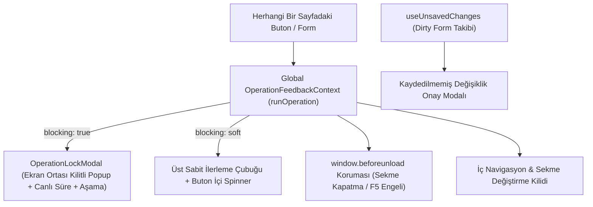

# Faz 7 — İşlem Geri Bildirimi (Yükleniyor Popup), Navigasyon Kilidi ve Sayfadan Çıkış Koruması Planı

> **İlgili Takip Dosyaları:** `DENETIM_RAPORU_VE_TAKIP.md`, `FAZ_1_ACIL_GUVENLIK_PLANI.md` – `FAZ_6_HEPSIBURADA_API_TAM_ENTEGRASYON_PLANI.md`  
> **Kapsam:** Tüm sayfalar ve görünümler (`src/app/page.tsx`, `src/app/login/page.tsx`, `XmlView.tsx`, `ProductsView.tsx`, `CatalogMappingsView.tsx`, `BulkAndRobotView.tsx`, `HepsiburadaLivePanel.tsx`, `OrdersAndClaimsView.tsx`, `SettingsAndAdminView.tsx`, `GeneralSettingsPanel.tsx`)  
> **Temel Hedef:** Projedeki hiçbir buton tıklaması veya API işlemi sessiz/belirsiz kalmayacak; uzun ve kritik işlemlerde ekran ortasında aşamalı + süre sayaçlı **"İşlem Devam Ediyor"** popup/modalı açılacak; işlem sürerken veya kaydedilmemiş form değişikliği varken kullanıcının yanlışlıkla sekmeden/sayfadan çıkması engellenecek.

---

## 1. Mevcut Durum Analizi (Sayfa Sayfa Tespit Edilen UX Açıkları)

Kod tabanındaki **10 arayüz dosyası** ve **40+ asenkron aksiyon** incelendiğinde tespit edilen temel sorunlar:

### 1.1. Mimari Kök Sorunlar
1. **Merkezi İşlem Kilidi / Yükleniyor Popup'ı Yok:** Her görünüm kendi içinde izole `loading` boolean'ları (`loading`, `tyLoading`, `syncingId`, `reconciling`, `savingWizard` vb.) tutuyor; üst kabuk (`src/app/page.tsx`) alt bileşenlerde kritik bir işlem çalıştığını **hiç bilmiyor**.
2. **Tarayıcı Sekme Kapatma / Yenileme (`beforeunload`) Koruması Yok:** Projenin hiçbir dosyasında `beforeunload` dinleyicisi bulunmuyor. 1.600 ürünlük XML çekimi veya Hepsiburada/Trendyol toplu gönderimi sürerken `F5` veya sekme kapatma yapılırsa tarayıcı uyarmadan bağlantıyı kesiyor.
3. **Menü / Sekme Değiştirme Engeli Yok:** `navigateTo()` (`page.tsx:130`), mobil alt bar (`page.tsx:954`), mağaza değiştirici (`page.tsx:503`) ve görünüm içi alt sekmeler aktif bir API isteği sürerken bileşeni anında unmount ediyor; geri dönüşte işlem durumu kayboluyor.
4. **18+ Butonda Hiçbir Görsel Yükleniyor İbaresi Yok:** Tıklandığında ne popup açılan ne de metni/ikonu değişen butonlar nedeniyle kullanıcı 5–90 saniye boyunca sistemin çalışıp çalışmadığını anlayamıyor.
5. **Kaydedilmemiş Form (`Dirty State`) Koruması Yok:** 4 adımlı XML Sihirbazı, 65 alanlı Genel Ayarlar, Pazaryeri API formları ve Ürün/Kategori düzenleme modallarında kaydetmeden çıkıldığında tüm değişiklikler uyarısız siliniyor.
6. **Veri Yenileme (`onRefresh` / `fetchState`) Aşaması Görünmez:** İşlem tamamlandıktan sonra 1.600+ ürünün Supabase'den yeniden çekildiği 2–4 saniyelik `onRefresh()` aşamasında kullanıcıya geri bildirim verilmiyor.

---

### 1.2. Sayfa ve Bileşen Bazlı Eksik Envanteri (Tam Liste)

| # | Sayfa / Bileşen | İşlem / Buton | Mevcut Durum (Sorun) | Hedef Koruma Seviyesi |
| :-: | :--- | :--- | :--- | :--- |
| **1** | `app/login/page.tsx` | Giriş Yap / Mağazamı Oluştur (`handleSubmit`) | Yalnızca buton metni `"İşleniyor..."` oluyor; form inputları ve Giriş/Kayıt sekme geçişi kilitlenmiyor, yönlendirme (`router.push('/')`) anında kilit erken kalkıyor. | **Orta** (Form kilidi + yönlendirme tamamlanana kadar tam overlay) |
| **2** | `app/page.tsx` (Ana Kabuk) | Aktif Mağaza Değiştir (`handleQuickSwitchTenant`) | Hiçbir yükleniyor göstergesi yok; eski mağaza verisi ekranda kalırken arka planda sessizce istek atılıyor. | **Kritik Bloklayıcı Modal** (*"Mağaza Değiştiriliyor..."*) |
| **3** | `app/page.tsx` (Ana Kabuk) | Çıkış Yap (`handleLogout`) | Hiçbir yükleniyor göstergesi yok, çift tıklamaya açık. | **Orta** (*"Güvenli çıkış yapılıyor..."* overlay) |
| **4** | `XmlView.tsx` | **Canlı XML Çek** (`handleSyncLiveXml`) | 15–60 sn sürebiliyor; sadece küçük buton `"Çekiliyor..."` oluyor. Kullanıcı menüden başka sayfaya geçebiliyor veya sekmeyi kapatabiliyor! | **Kritik Bloklayıcı Modal** + Süre Sayacı + Çıkış Kilidi |
| **5** | `XmlView.tsx` | **AI Yasaklı Kelime & Çoklanan Ürün Taraması** (`handleRunAiComplianceGuard`) | Tüm kataloğu tarayıp DB'ye yazıyor; popup yok, sayfadan çıkış serbest. | **Kritik Bloklayıcı Modal** + Çıkış Kilidi |
| **6** | `XmlView.tsx` | **XML Sihirbazı: Etiketleri Test Et** (`handleInspectXmlNodes`) | Uzak XML'i indirip parse ediyor (5–20 sn); popup yok, adım değiştirilebiliyor. | **Kritik Bloklayıcı Modal** (*"XML Kaynağı Analiz Ediliyor..."*) |
| **7** | `XmlView.tsx` | **XML Sihirbazı: Onayla ve Bitir** (`handleSaveWizard`) & **XML Sil** (`handleDeleteXml`) | Silmede hiç spinner/metin değişimi yok; sihirbazda değişiklik yapıp `"XML Kaynaklarına Dön"` veya sol menüye basılınca **uyarısız veri kaybı** yaşanıyor. | **Kritik Bloklayıcı Modal** + **Dirty-Form Çıkış Onayı** + Modern Silme Onayı |
| **8** | `ProductsView.tsx` | **Ürün Kaydet & Güncelle** (`handleSaveProduct`) | Modal açıkken arka plana/X'e/Vazgeç'e basılınca kayıt sırasında modal kapanabiliyor; düzenlenmiş formdan uyarısız çıkılıyor. | **Yumuşak Bloklayıcı** (Modal içi kilitli yükleme katmanı + Dirty-Form onayı) |
| **9** | `CatalogMappingsView.tsx` | **Tüm Kategorileri Otomatik Eşitle** (`handleAutoMatchCategories`) | Canlı Hepsiburada MPOP yaprak kategorilerini çekip 75 kategoriyi eşitliyor (5–15 sn); **buton metni dahi değişmiyor**, popup yok! | **Kritik Bloklayıcı Modal** + Süre Sayacı + Çıkış Kilidi |
| **10** | `CatalogMappingsView.tsx` | **Tüm Markaları Eşitle** (`handleAutoMatchBrands`) & **Seçenek Gruplarını Eşitle** (`handleAutoMatchVariants`) | Buton metni değişmiyor, spinner/popup yok, tek bir ortak `loading` state kullanıldığı için diğer butonlar belirsiz kalıyor. | **Kritik Bloklayıcı Modal** |
| **11** | `CatalogMappingsView.tsx` | **Canlı HB Kategori Ara**, **HB Kategori Seç (Özellik Çek)**, **Tekil Kategori Kaydet** | Özellik çekilirken (`hbAttrLoading`) kullanıcı hiçbir yükleme göstergesi görmeden `"Kaydet"` butonuna basabiliyor! | **Yumuşak Bloklayıcı** (Modal içi kilit + net spinner) |
| **12** | `BulkAndRobotView.tsx` | **Toplu Ürün Gönderimi** (`handleBulkPublish` — TY / HB / Tümü) | En ağır işlem (10–120 sn, binlerce varyant + MPOP şema + tracking kontrolü); sadece buton `"Gönderiliyor..."` oluyor, **popup yok, sekmeden/menüden çıkış tamamen serbest!** | **Kritik Bloklayıcı Modal** + Canlı Süre + Aşama Bilgisi + Tam Çıkış Kilidi |
| **13** | `BulkAndRobotView.tsx` | **Stok & Fiyatları Şimdi Güncelle** / **Tüm Farklılıkları Eşitle** (`handleBulkUpdate`) | **Buton metni bile değişmiyor!** Binlerce varyant pazaryerine gönderilirken ekran tamamen hareketsiz görünüyor. | **Kritik Bloklayıcı Modal** + Süre Sayacı + Çıkış Kilidi |
| **14** | `BulkAndRobotView.tsx` | **Fiyat Ayarını Kaydet & Tüm Ürünlere Uygula** (`handleApplyQuickPriceRules`) | 1.600+ ürünün fiyatını yeniden hesaplayıp kaydediyor; popup ve navigasyon kilidi yok. | **Kritik Bloklayıcı Modal** + Çıkış Kilidi |
| **15** | `BulkAndRobotView.tsx` | **Buybox Robotu Şimdi Çalıştır** (`handleRunPriceRobot`) & **Robota Ürün Ekle** & **Tracking Sorgula** | `"Robotu Şimdi Çalıştır"` ve `"Tracking Sorgula"` butonlarında **metin/spinner dahi değişmiyor!** | **Kritik Bloklayıcı Modal** (Robot) / **Yumuşak Bloklayıcı** (Tracking & Ekle) |
| **16** | `BulkAndRobotView.tsx` (`trendyol_live`) | **Canlı Trendyol Ürünleri Çek**, **1. Adım Arşivle**, **2. Adım Kalıcı Sil** | Çok sayfalı silme/arşivleme 15–45 sn sürebiliyor; popup yok, sekme değiştirilebiliyor! | **Kritik Bloklayıcı Modal** (Arşiv/Sil) + Tablo İskelet/Overlay (Liste Çekme) |
| **17** | `HepsiburadaLivePanel.tsx` (`hepsiburada_live`) | **Satışa Aç / Kapat**, **Ön Eşleşme Onayla**, **Onay Bekleyenleri Sil**, **HB Durumlarını Mağaza ile Eşitle** | Durum eşitleme tüm HB listing + katalog sayfalarını tarıyor (10–30 sn); diğer 4 toplu aksiyonda buton metni değişmiyor, popup ve çıkış kilidi yok. | **Kritik Bloklayıcı Modal** + Süre Sayacı + Tablo Yükleme Katmanı |
| **18** | `OrdersAndClaimsView.tsx` | **Hızlı Sipariş Getir**, **Test Siparişi**, **Canlı İadeleri Getir**, **HB İade Onayla/Reddet**, **Sipariş Durumu `<select>`**, **Fatura Kes**, **Resmi HB PDF Etiketi** | **7 aksiyonun hiçbirinde ne spinner ne metin değişimi ne de popup var!** Özellikle sipariş durumu `<select>` ve `"Fatura Kes"` tıklandığında 2–5 sn hiçbir tepki görünmüyor. | **Kritik Bloklayıcı Modal** (Sipariş/İade Çekme & İade Kararı) + **Satır/Modal Kilidi** (Durum, Fatura, PDF Etiket) |
| **19** | `SettingsAndAdminView.tsx` & `GeneralSettingsPanel.tsx` | **Trendyol / HB Ayarlarını Kaydet & Test Et**, **Genel Ayarları Kaydet**, **Logo Yükle**, **Süper Admin Mağazaya Geç** | `"Kaydet & Test Et"` ve `"Mağazaya Geç"` butonlarında **metin/spinner değişmiyor**; 65 ayarlık formda veya API formunda değişiklik yapıp kaydetmeden başka menüye geçildiğinde **uyarı çıkmıyor**. | **Kritik Bloklayıcı Modal** (API Test, Ayar Kaydet, Mağaza Geçişi) + **Dirty-Form Koruması** |

---

## 2. Hedef UX Mimarisi (3 Temel Bileşen)

Kullanıcıyı gereksiz tıklamalarla yormadan **%100 işlem görünürlüğü ve veri güvenliği** sağlayacak merkezi mimari:

### 2.1. `OperationFeedbackProvider` & `useOperation()` Hook'u (`src/components/ui/OperationFeedbackContext.tsx`)
- Tüm uygulama `src/app/page.tsx` (ve `login`) seviyesinde bu sağlayıcıyla sarılır.
- Tek bir standart çağrı ile hem API isteği hem de arkasından gelen `onRefresh()` veri güncellemesi tek atomik işlem olarak yönetilir:
  - **Aşama 1:** İşleme özel başlık ve açıklama (*"Hepsiburada'ya Ürünler Gönderiliyor — MPOP paketleri aktarılıyor..."*)
  - **Aşama 2 (`onRefresh`):** *"Panel verileri güncelleniyor..."* (böylece tablo yenilenene kadar popup erken kapanmaz!)
- Aktif bir işlem varken:
  - `isBusy === true` olur; mükerrer tıklamalar (double-submit) merkezi olarak engellenir.
  - `window.beforeunload` otomatik aktifleşir (kullanıcı sekmeyi kapatmaya veya `F5` yapmaya kalkarsa tarayıcı standart *"Yaptığınız değişiklikler kaydedilmeyebilir / İşlem devam ediyor"* uyarısını çıkarır).

### 2.2. `OperationLockModal` — Devam Eden İşlem Popup'ı (`src/components/ui/OperationLockModal.tsx`)
- Ekran ortasında (`z-[80]`, arka plan bulanık karartmalı `backdrop-blur-sm`, ESC ve dış tıklamaya kapalı) açılır:
  - Üstte dönen modern animasyonlu ikon + **İşlem Başlığı**
  - **Alt açıklama / Aşama bilgisi** (Örn: *"Lütfen bekleyin, pazaryeri sunucusundan yanıt bekleniyor..."*)
  - **Canlı Geçen Süre Sayacı (`00:08`)** + akıcı belirsiz ilerleme çubuğu (*indeterminate progress bar*) — kullanıcı işlemin donmadığını saniye saniye görür.
  - Alt bilgi kutusu: *"⚠️ İşlem tamamlanana kadar lütfen bu sayfadan ayrılmayın ve pencereyi kapatmayın."*
- **Hızlı İşlemler (`soft` mod):** Tablo sayfalama veya küçük sorgularda tüm ekranı kilitlemek yerine 150ms gecikmeli üst ince ilerleme şeridi + ilgili kart/tablo üzerinde yarı saydam yükleme katmanı (`SectionBusyOverlay`) ve buton içi `<Loader2 className="animate-spin" />` gösterir.

### 2.3. İç Navigasyon Kilidi + Kaydedilmemiş Değişiklik (`Dirty Form`) & Modern Onay Modalı (`ConfirmModal`)
- **Aktif İşlemde Menü Koruması:** İşlem sürerken sol menü, mobil alt bar, üst kısayollar veya alt sekmelere tıklanırsa geçiş yapılmaz; kısa bir uyarı gösterilir (*"Devam eden işlem tamamlanmadan sayfa değiştirilemez."*).
- **Kaydedilmemiş Form (`isDirty`) Koruması:** XML Sihirbazı (`XmlView`), Genel Ayarlar (`GeneralSettingsPanel`), Pazaryeri API formları (`SettingsAndAdminView`), Ürün Düzenleme (`ProductsView`) ve Kategori Eşitleme (`CatalogMappingsView`) ekranlarında değişiklik yapılıp kaydedilmeden başka menüye/sekmeye geçilmek istenirse modern **`ConfirmModal`** açılır:
  - *"Kaydedilmemiş değişiklikleriniz var. Sayfadan ayrılırsanız yaptığınız düzenlemeler kaybolacaktır."* → **[Sayfada Kal]** / **[Kaydetmeden Çık]**.
- **Tarayıcı `window.confirm` / `window.prompt` Değişimi:** Silme, arşivleme, satışa kapatma ve HB iade onay/red işlemlerindeki ilkel tarayıcı pencereleri mobil/PWA uyumlu kurumsal **`ConfirmModal`** bileşenine taşınır.

---

## 3. Atomik Uygulama Adımları (6 Adım — Tamamlandı)

- [x] **Adım 1: Merkezi İşlem & Onay Altyapısını Oluştur (`src/components/ui/`)**
  - Oluştur: `src/components/ui/OperationFeedbackContext.tsx` (`OperationFeedbackProvider`, `useOperation`, `OperationLockModal`, üst `TopProgressBar`, `beforeunload` koruyucusu ve `ConfirmModal` / `PromptModal` diyaloğu).
  - Oluştur: `src/hooks/useUnsavedChanges.ts` (kirli form durumu `isDirty` takibi + `beforeunload` bağlantısı).

- [x] **Adım 2: Ana Kabuk (`src/app/page.tsx`) ve Giriş Sayfasını (`src/app/login/page.tsx`) Korumaya Al**
  - `page.tsx`: `OperationFeedbackProvider` entegrasyonu; `navigateTo`, mobil alt menü, üst bar butonları, mağaza değiştirici (`handleQuickSwitchTenant`) ve çıkış (`handleLogout`) aksiyonlarını işlem kilidi ve `isDirty` kontrolüne bağla.
  - `login/page.tsx`: Giriş ve yeni mağaza kaydı sırasında formu + sekme geçişini kilitleyen ve yönlendirme tamamlanana kadar açık kalan işlem katmanı ekle.

- [x] **Adım 3: Ağır Senkronizasyon Görünümlerini Bağla (`XmlView.tsx`, `BulkAndRobotView.tsx`, `HepsiburadaLivePanel.tsx`)**
  - `XmlView.tsx`: Canlı XML Çek, AI İhlal Taraması, Etiketleri Test Et, Sihirbaz Kaydet ve XML Sil işlemlerini `runOperation` (bloklayıcı modal + aşama mesajı) ve modern `ConfirmModal` ile sar; 4 adımlı sihirbaza `isDirty` çıkış koruması ekle. Ham `fetch()` çağrılarını merkezi `apiPost` yapısına geçir.
  - `BulkAndRobotView.tsx` & `HepsiburadaLivePanel.tsx`: Toplu Ürün Gönderimi, Toplu Stok/Fiyat Güncelleme, Farklılık Eşitleme, Hızlı Fiyat Kuralı Uygulama, Buybox Robotu Çalıştırma, Trendyol Arşivle/Sil, HB Satışa Aç/Kapat/Ön Eşleşme/Sil/Durum Eşitleme işlemlerini bloklayıcı popup'a bağla; canlı tablo yüklemelerine net tablo üstü yükleme katmanı ekle; alt sekme geçişlerini işlem sürerken kilitle.

- [x] **Adım 4: Katalog & Ürün Yönetimi Görünümlerini Bağla (`ProductsView.tsx`, `CatalogMappingsView.tsx`)**
  - `ProductsView.tsx`: Ürün kaydetme modalında kayıt sürerken form/kapatma kilidi ve yükleniyor katmanı ekle; değişiklik yapılmış ürün modalını kapatırken `isDirty` onayı sor.
  - `CatalogMappingsView.tsx`: Tüm Kategorileri / Markaları / Seçenekleri Otomatik Eşitle butonlarına bloklayıcı popup + süre sayacı ekle; tekil kategori modalında canlı HB kategori arama ve zorunlu özellik çekme sırasında net yükleniyor göstergesi ve `"Kaydet"` kilidi uygula.

- [x] **Adım 5: Sipariş, İade, Entegrasyon ve Genel Ayarlar Görünümlerini Bağla (`OrdersAndClaimsView.tsx`, `SettingsAndAdminView.tsx`, `GeneralSettingsPanel.tsx`)**
  - `OrdersAndClaimsView.tsx`: Canlı Sipariş Getir, Test Siparişi, Canlı İadeleri Getir, HB İade Onayla/Reddet (modern `ConfirmModal`/`PromptModal` ile), Sipariş Durumu değiştirme, Fatura Kesme ve Resmi HB PDF Kargo Etiketi indirme işlemlerinin tamamına görünür yükleniyor geri bildirimi ve işlem kilidi ekle.
  - `SettingsAndAdminView.tsx` & `GeneralSettingsPanel.tsx`: Trendyol/HB API Kaydet & Test Et, Genel Ayarları Kaydet, Logo Yükle (`/api/upload/logo`) ve Süper Admin Mağazaya Geç işlemlerini işlem popup'ına bağla; 65 ayarlık form ve API formlarına `isDirty` kaydedilmemiş değişiklik koruması ekle.

- [x] **Adım 6: Doğrulama, Tip Kontrolü, Build ve Canlı Yayın**
  - `npx tsc --noEmit` ve `npm run build` ile sıfır hata doğrulaması yap.
  - Masaüstü ve mobil (iOS PWA safe-area dahil) görünümlerde modal z-index katmanlarını (`Toast z-[90]` > `TopProgressBar z-[85]` > `OperationLockModal z-[80]` > `ConfirmModal z-[75]` > `Sayfa Modalları z-50`) doğrula.
  - `DENETIM_RAPORU_VE_TAKIP.md` ve `FAZ_7_ISLEM_GERIBILDIRIM_VE_SAYFA_KORUMA_PLANI.md` kayıtlarını güncelleyip canlıya çık.
